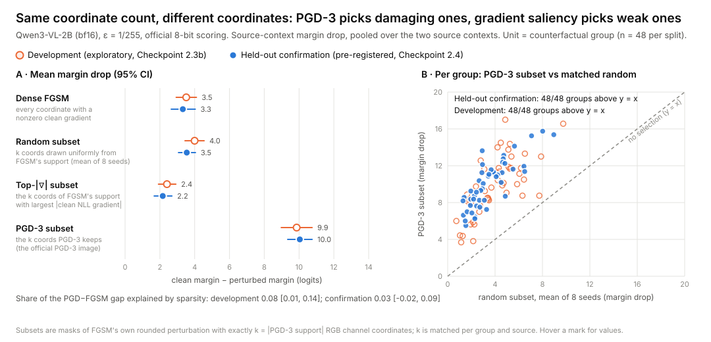

# Which coordinates, not how many

**Pre-registered, held-out evidence that 3-step PGD's advantage over FGSM on a vision-language model comes from *which* RGB channel coordinates it perturbs, and that two standard clean-gradient rules rank those coordinates below random.**

Federico Cavaletto · 2026 · Qwen3-VL-2B-Instruct · L∞ ε = 1/255 · Apple-silicon laptop, no paid compute



**Figure 1.** **(A)** Mean margin drop, with 95% group-bootstrap CIs, for four perturbations of the same image in the same ε-ball:
- dense FGSM;
- a random subset of FGSM's perturbation;
- the subset with the largest clean-gradient magnitude;
- the subset that PGD-3 keeps.

All three subsets have exactly the same number of coordinates and FGSM's own signs. Orange markers are the development data; blue markers are the pre-registered held-out confirmation. **(B)** One point per scene group. PGD-3's subset beats a same-size random subset in every group of both samples.

## What we found

At the smallest meaningful budget, one 8-bit level per channel, 3-step PGD does about **3× the damage** of FGSM on a 2B-parameter vision-language model. After the official 8-bit rounding, the PGD-3 image is *exactly* FGSM restricted to about 30% of its RGB channel coordinates, with the same signs. This follows from the arithmetic of three ε/4 sign steps (see [the report, §3](docs/checkpoint-2.4-confirm/REPORT.md#3-a-structural-fact-that-is-not-the-finding)). It allows a clean decomposition: hold the perturbation values, signs and count fixed, and change only *which* coordinates are kept.

On **48 newly generated scene groups**, analyzed under a protocol hash-frozen and pushed before any inference ([`PROTOCOL.md`](docs/checkpoint-2.4-confirm/PROTOCOL.md), commit `c35b02c`):

| Pre-registered prediction | Held-out result (95% CI) | |
|---|---|---|
| PGD-3's coordinates beat random coordinates at the same count | **+6.50 logits** margin damage [6.08, 6.92]; positive with either context as source; 96/96 group-by-source cases | supported |
| Sparsity explains at most 25% of the PGD-versus-FGSM gap | **3%** [−2%, 9%] | supported |
| Top-\|clean gradient\| coordinates are worse than random | **−1.38 logits** [−1.71, −1.06] | supported |

- On scenes the model answered correctly, PGD-3's subset changed the answer in 60–78% of cases, against 18–23% for random subsets of the same size.
- The selection effect carries almost undiminished to the context the image was not optimized for.
- The clean first-order prediction ranks the subsets backwards. It rates PGD's subset at 0.92× random and the top-gradient subset at 2.8× random. In reality PGD's subset does 2.8× random and the top-gradient subset does 0.6×.

**Why it matters for safety evaluation.** Single-step attacks, magnitude saliency and first-order damage estimates are the cheapest tools for estimating how vulnerable a model is and for locating which inputs matter. Here they misjudge both: they underestimate the vulnerability, and they point to the wrong coordinates. Iterative attacks, scored after quantization, are the stable measurement.

**What this does not show.** It does not show that the clean gradient carries *no* information about the damaging coordinates. Only two rules were tested, magnitude ranking and the first-order prediction. It also does not explain *why* PGD's coordinates are damaging, and it covers one model, one synthetic task family, one ε and one precision.

## Status of each claim

| | Claim | Where |
|---|---|---|
| **Confirmed** (pre-registered, held-out) | Selection, not sparsity, explains PGD-3's advantage. Top-\|∇\| selection is worse than random. | [Checkpoint 2.4 report](docs/checkpoint-2.4-confirm/REPORT.md) |
| **Structural** (arithmetic) | Under these settings the PGD-3 image is a sign-preserving FGSM subset. The only exceptions are 0–7 half-level ties per image, at coordinates with exactly zero gradient. | Report §3, §5.6 |
| **Exploratory** (development data) | Gradients decorrelate after one ε/4 step. bf16 vision rotates the gradient but not the attack outcome. A slight cross-context asymmetry. | [Checkpoint 2.3 report](docs/checkpoint-2.3-exploratory/REPORT.md) |
| **In progress** (development-only pilot) | Does gradient sign consensus at random nearby points reproduce PGD's selection? | [Checkpoint 3 plan](docs/checkpoint-3-mechanism/PLAN.md) |
| **Not established** | The mechanism; generality to other models, budgets and precisions. | Report §7 |

## Read next

- **Manuscript (preprint-style):** [`docs/paper/MANUSCRIPT.md`](docs/paper/MANUSCRIPT.md)
- **Full confirmation report:** [`docs/checkpoint-2.4-confirm/REPORT.md`](docs/checkpoint-2.4-confirm/REPORT.md)
- **Frozen protocol and hashes:** [`PROTOCOL.md`](docs/checkpoint-2.4-confirm/PROTOCOL.md), [`FROZEN.json`](docs/checkpoint-2.4-confirm/FROZEN.json)
- **One-page research summary:** [`docs/RESEARCH_SUMMARY.md`](docs/RESEARCH_SUMMARY.md)

## Reproduce

You need Apple silicon with about 12 GiB free, Python with torch, transformers and Pillow 11.3.0, and the pinned Qwen3-VL-2B weights present locally. The scripts never download them.

```bash
export PYTHONPATH=$(ls -d src/*/ | tr '\n' ':')
```

Model-free tests (generator, masks, structure, toy model):

```bash
python -m pytest -q tests/scene_confirm tests/path_probe tests/scene_v4
```

Regenerate the held-out split, which is byte-identical to `fixtures/trackB_confirm_v1/checksums.json`:

```bash
python -m scene_confirm --output /tmp/confirm_check
```

Re-run the frozen analysis on the committed records, and redraw Figure 1:

```bash
python docs/checkpoint-2.4-confirm/analyze_confirm.py
```

```bash
python docs/checkpoint-2.4-confirm/make_figure.py
```

The full confirmation run takes about 2.7 h. It refuses to start unless every frozen hash matches, and it refuses to overwrite earlier records:

```bash
python -m path_probe confirm
```

See [report §8](docs/checkpoint-2.4-confirm/REPORT.md#8-reproducibility) for the development-scene bit-exact smoke test and determinism notes.

## How the project got here

The project began as **Study 2**: does gradient sign alignment between two non-revealing text contexts predict whether an image attack transfers between them? That hypothesis, H\*, was pre-registered and stopped at Checkpoint 2.1 because too few transfer failures occurred to estimate it (4 against a floor of 40). It is reported as it stands ([`docs/checkpoint-2.1/`](docs/checkpoint-2.1/)).

Diagnosing why gradient geometry predicted so little led to the exploratory Checkpoint 2.3, which observed that single-step attacks and first-order reasoning fail on this model. A pre-registered random-mask control (2.3b) isolated coordinate selection. Checkpoint 2.4 then confirmed it on a newly generated, independently seeded split.

Every checkpoint keeps its plan, frozen records and deviations. Earlier results are never edited, only annotated with dated notes.

| Path | Content |
|---|---|
| `docs/checkpoint-2.4-confirm/` | **Held-out confirmation:** protocol, freeze, records, analysis, report, figure |
| `docs/checkpoint-2.3-exploratory/` | Exploratory path, precision and mask-control studies |
| `docs/checkpoint-3-mechanism/` | Mechanism plan and development-only pilot |
| `docs/checkpoint-0` … `2.2-draft` | Study 2 design, measurement and attack protocols, H\*, audits |
| `docs/research/` | Literature review and prior-art matrix |
| `src/` | Scene generators, scoring, attack and probe code |
| `fixtures/` | Rendered development and confirmation scenes, with manifests and hashes |

## Citation

```
Cavaletto, F. (2026). Which coordinates, not how many: held-out evidence that 3-step PGD's
advantage over FGSM on a vision-language model is coordinate selection.
https://github.com/fcavaletto/vlm-crossmodal-attack-transfer
```
