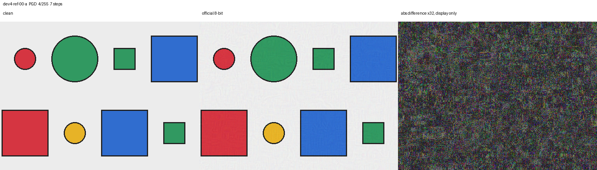

# Checkpoint 1.9 review packet

DEVELOPMENT ONLY. Research lead: Federico Cavaletto. Qwen3-VL-2B-Instruct, bfloat16, MPS. No H* fit. No held-out scenes. Not merged.

The protocol is commit `fce3480d158298851587a692c56b6e4eebb554a7`. It was not rewritten. Pull request: https://github.com/fcavaletto/vlm-crossmodal-attack-transfer/pull/19. The pull request targets `checkpoint-1.8/qwen-rgb-loss`, not `main`.

## What was asked

The loss is the summed negative log-likelihood of the scene's own color, read from the first continuation logit. The colors are the bare tokens red 1151, blue 12203, green 13250, and yellow 27869. The answer prefix is `<|im_end|>\n<|im_start|>assistant\n`. Token 2518, the leading-space piece ` red`, is not the continuation. The mean over tokens is not the loss.

The gradient is the derivative of that scalar with respect to canonical float RGB in [0, 1], through the same unclipped differentiable path as Checkpoint 1.8. A positive step adds epsilon times the sign of that gradient. A negative step subtracts it. A matched random step uses a fixed Rademacher field on the same pixels the gradient actually moves. Each proposal is then projected with `qwen_rgb.constraints.project_linf` onto the L-infinity ball around the clean image, intersected with [0, 1]. The official 8-bit image is that projection passed through half-to-even rounding to multiples of 1/255.

Epsilon is on the [0, 1] scale. A budget of `k/255` means each channel may move by at most k levels of an 8-bit image. `1/255` is one stored level. `0.5/255` is half a level, so rounding can erase it. `4/255` is 0.01569, next to the Checkpoint 1.8 finite-difference step of `1/64` = 0.015625.

Stage A is eight scenes and four budgets. It passes only when every budget raises the float loss on at least 6 of 8 scenes, beats both controls on at least 6 of 8, and has a positive median strictly above both control medians. A missing change is not filled in as zero. Stage B is allowed only after that pass. Stage B is sixteen scenes, source text neutral, seven projected steps of length epsilon/4, epsilon in {1, 2, 4}/255, one clean-image init, no restarts. Success counts are conditional on a correct clean answer.

## The memory guard

The guard is the Checkpoint 1.5 budget. It was not lowered.

The first reading, kept in `budget_decision_history`, refused the load. OS-available memory was 11,093,655,552 bytes. Bfloat16 requires 11,509,447,200. The shortfall was 415,791,648 bytes. `from_pretrained` was not called.

A later reading cleared bfloat16 and did not clear float32. The load that finished the run saw 15,463,792,640 bytes available. The selected dtype was bfloat16. The model was `Qwen/Qwen3-VL-2B-Instruct` at revision `89644892e4d85e24eaac8bacfd4f463576704203`, eager attention. `config._commit_hash` was null, as in Checkpoint 1.8. The call used the pinned revision, and the Stage A losses matched the stored Checkpoint 1.7 rows with maximum absolute gap 0.

One process loads the weights at most once. This checkpoint used two processes. The first completed Stage A and the first Stage B scene. It was stopped after that scene had been saved. The second process loaded Qwen once, skipped finished scenes, and finished the list. It did not recompute those scenes and did not change the objective.

During the runs, the lowest OS-available reading kept in the record was 7,071,186,944 bytes, above the 6 GiB floor of 6,442,450,944. Peak process RSS was 692.6 in the snapshot's mebibyte field. MPS current allocation peaked at 4072.9 in that field, and the driver allocation at 4749.7.

## Stage A

Rule `per-color-extreme-alignment-exploratory`. Within each labeled color, the lowest and highest Checkpoint 1.8 value of \(A(\text{neutral}, \text{helpful})\) are kept. The sample is exploratory. It cannot support an unbiased population attack-success rate. The alignments below are the stored Checkpoint 1.8 numbers. They were not regressed on these steps.

| Scene | Label | Stratum | Stored alignment | Neutral margin | Gradient L1 |
| --- | --- | --- | ---: | ---: | ---: |
| `dev4-ref-01-a` | red | lowest in color | 0.274 | 12.50 | 54.7 |
| `dev4-ref-09-b` | red | highest in color | 0.935 | 1.50 | 9840.8 |
| `dev4-ref-25-a` | blue | lowest in color | 0.494 | 13.25 | 34.2 |
| `dev4-ref-21-b` | blue | highest in color | 0.952 | 7.00 | 377.5 |
| `dev4-ref-30-b` | green | lowest in color | 0.588 | 6.50 | 643.9 |
| `dev4-ref-07-a` | green | highest in color | 0.978 | 2.25 | 27271.3 |
| `dev4-ref-17-b` | yellow | lowest in color | 0.197 | 10.38 | 396.7 |
| `dev4-ref-45-b` | yellow | highest in color | 0.975 | 8.63 | 1561.3 |

All eight neutral gradients were finite and nonzero. All eight float32 hashes matched the Checkpoint 1.8 neutral hashes. Context was neutral.

The gate quantity is the change in labeled-color loss on the differentiable path after projection. The table counts scenes out of 8.

| Budget | Raised the loss | Beat the negative step | Beat the random step | Median positive change | Median negative change | Median random change | Passed |
| --- | ---: | ---: | ---: | ---: | ---: | ---: | --- |
| 0.5/255 | 8/8 | 8/8 | 8/8 | 0.070 | −0.014 | 0.0027 | yes |
| 1/255 | 8/8 | 8/8 | 8/8 | 0.031 | −0.012 | −0.00023 | yes |
| 2/255 | 8/8 | 8/8 | 8/8 | 0.051 | −0.0058 | −0.000087 | yes |
| 4/255 | 7/8 | 8/8 | 7/8 | 0.025 | −0.012 | −0.00090 | yes |

Every budget passed the precommitted rule, so Stage B was started. The 8-bit images raised the loss on the same 8/8, 8/8, 8/8, and 7/8 scenes. Directional agreement of the predicted and observed float changes was 8/8, 8/8, 8/8, and 7/8.

The miss is `dev4-ref-09-b` at 4/255. The positive step changed the loss by −0.0066. The predicted first-order change was +154.4. The random step changed it by +0.221, so the positive step did not beat that control. The gradient L1 on that scene is 9841, far above the Stage A median scale. The same scene's positive step did raise the loss at 0.5/255, 1/255, and 2/255, and those three steps changed the closed-vocabulary answer from red to yellow.

A single positive step changed the answer on two scenes: `dev4-ref-09-b` at the three smaller budgets, and `dev4-ref-07-a` at all four. Both have the large gradients and the small clean margins in the table above. The other six scenes kept their clean answer at every Stage A budget. Their margins are several nats, and a single step of at most 4/255 did not cross them.

The first-order prediction was much larger than the observed change. On `dev4-ref-01-a` at 0.5/255 the prediction was 0.107 and the observed change was 0.016. On the missed cell the prediction had the wrong sign relative to the outcome. This sits next to the Checkpoint 1.8 finite-difference failure: that check confirmed one of eight gate pairs, and only at the smaller step. This checkpoint did not rerun it and does not replace it. A sign step can still move the loss in the predicted direction when the size of the move is not the linear prediction.

Stage A model time, summed over the eight scenes, was 326.4 seconds.

## Stage B

Rule `scene-id-stride-6`: scene ids sorted, indexes 0, 6, ..., 90. The rule does not read alignment, margin, or a score. Sixteen development scenes. All sixteen had a correct clean answer under both neutral and helpful text on this run, so every denominator below is 16. That was not a selection criterion. The subset is not a population attack-success rate.

The attack maximizes the labeled-color loss under neutral text. The stored attack is the official 8-bit image. A source flip is a correct clean neutral answer that is no longer the labeled color. A target flip is the same event under helpful text, on an image that was optimized under neutral only. Transfer is both of those on the same scene. Controls are one positive sign step (FGSM) and one matched random step, at the same epsilon.

| Budget | PGD source flips | PGD target flips | Transfer | FGSM source flips | Random source flips | Median PGD increase | Median FGSM increase | Median random increase |
| --- | ---: | ---: | ---: | ---: | ---: | ---: | ---: | ---: |
| 1/255 | 14/16 | 13/16 | 13/16 | 4/16 | 0/16 | 8.50 | 0.070 | −0.0009 |
| 2/255 | 14/16 | 13/16 | 13/16 | 2/16 | 0/16 | 8.63 | 0.128 | 0.00008 |
| 4/255 | 15/16 | 15/16 | 15/16 | 2/16 | 0/16 | 9.11 | 0.068 | −0.0049 |

PGD was effective at every listed budget under the precommitted rule: the source-flip count was not zero, and the median labeled-loss increase beat both controls. Epsilon was not raised. The objective was not changed.

The scenes that stayed on the labeled color under neutral PGD were `dev4-ref-27-a` and `dev4-ref-42-a` at 1/255, `dev4-ref-15-a` and `dev4-ref-27-a` at 2/255, and `dev4-ref-15-a` at 4/255. Their stored neutral margins are 12.25, 11.75, and 13.00. Their stored alignments are 0.898, 0.703, and 0.804. The other attacked scenes have stored neutral margins from 1.50 to 11.50 and stored alignments from 0.661 to 0.956. The three scenes that stayed are inside that alignment range. These numbers describe the sixteen scenes. They are not a regression, and they are not evidence that alignment predicts transfer.

The float-path source-flip counts matched the 8-bit counts above. Exact L-infinity distance of the projected image, and of the 8-bit image against the clean image, sat on the budget: 1/255, 2/255, or 4/255. The share of pixels that changed in the 8-bit image was about 0.81 to 0.84 at 1/255, about 0.97 at 2/255, and 1 at 4/255. Rounding did not remove these steps.

Stage B model time, summed over the sixteen scenes, was 7878.2 seconds. The process that finished the run recorded 7447.3 seconds of wall clock, including its own load of 3.6 seconds and not including the first process.

## One image

`dev4-ref-00-a`, PGD, epsilon 4/255, seven steps, official 8-bit image beside the clean image. The third panel is the absolute difference multiplied by 32 so the step can be seen. That panel is not a second attack.



The question on this scene asks for the small circle in the top row. The labeled color is red, and the clean decision was red. The 8-bit PGD decision was green under both neutral and helpful text. The circle is still red to the eye. The difference panel is dense speckle, which is what a sign step across the whole image looks like at a gain of 32.

## What this does not show

These fractions are 8 scenes and 16 scenes of the development set. They are not an attack-success rate for a larger population, and they are not a result on held-out images.

The Checkpoint 1.8 finite-difference failure remains a failure. This run did not replace it. The sign steps and the seven-step iteration moved the labeled-color loss anyway. The size of that move was not the dot product of the gradient with the step.

\(A(s, t)\) was used only to name the exploratory Stage A list. It was not regressed on a flip. H* was not fit. SmolVLM2 was not loaded. No pixel outside `development_v4` was opened.

## Threat and open questions

The perturbation is an L-infinity change to a development RGB image, scored as the labeled-color loss of this local Qwen checkpoint. It is not a measurement of a deployed system.

What is still open: whether the same steps succeed on images this run did not touch; whether another model behaves like this one; why the linear prediction is so much larger than the observed change, especially on the largest gradients; and why `dev4-ref-15-a` flipped at 1/255 and not at 2/255 or 4/255. Alignment was not tested as a predictor of transfer.

## Recommendation

On this development sample, a positive sign step beat both controls at every listed Stage A budget, and seven-step projected gradient ascent flipped most of the sixteen Stage B scenes at 1/255, 2/255, and 4/255. That is enough to treat the labeled-color gradient as a usable direction for a later, pre-registered evaluation. It is not enough to quote 14/16 or 15/16 as a rate beyond these scenes.

Do not fit H*. Do not open held-out scenes in this branch. Do not raise epsilon. Do not lower the memory guard. Do not merge to main.

## Files

- `docs/checkpoint-1.9/ATTACK_PROTOCOL.md`, sha256 `2676683793d908c9f5c8af9a46867d39d0ecea18cd5dbbe54144196153c78648`
- `docs/checkpoint-1.9/attack_feasibility/summary.json`, sha256 `06a0ed1e32cce96b2aa3138a111b33047196fbdd157d1899ce526eb13914e020`
- `docs/checkpoint-1.9/attack_feasibility/progress.json`, sha256 `ba66d39ae430628f1a8b28cb0b2f384bc34d78e0ec4fb0851e9a28f4521b65d8`
- `docs/checkpoint-1.9/figures/illustration.png`, sha256 `478a915bc5e1b28c816d394b6fa8d4e5843bc19638ced026333ce4b720b800e8`

Checkpoint 1.7 predictions and Checkpoint 1.8 gradient records were not edited. No raw gradient tensor is in the commit.

## Reproduction

From the worktree root. The unit tests do not load Qwen. The measurement command loads Qwen if the saved run is not already terminal. This run is terminal with status `completed`, so starting it again does not load the model.

```bash
HF_HOME=/Users/fedecava/Development/models/huggingface \
PYTHONPATH=src/attack_feasibility:src/qwen_rgb_loss:src/qwen_rgb:src/choice_eval:src/vlm_iface:src/pilot:src/dev_pilot:src/analysis:src/scene_v4 \
/Users/fedecava/Development/_c0-work/venv-vlm/bin/python -m pytest tests/attack_feasibility -q

HF_HOME=/Users/fedecava/Development/models/huggingface \
PYTHONPATH=src/attack_feasibility:src/qwen_rgb_loss:src/qwen_rgb:src/choice_eval:src/vlm_iface:src/pilot:src/dev_pilot:src/analysis:src/scene_v4 \
/Users/fedecava/Development/_c0-work/venv-vlm/bin/python -m attack_feasibility
```
