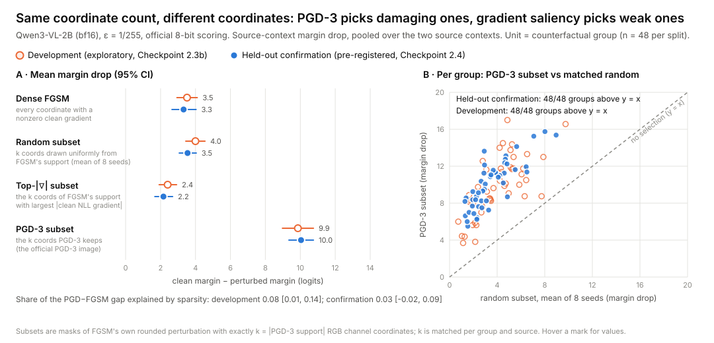

# Which coordinates, not how many: held-out evidence that 3-step PGD's advantage over FGSM on a vision-language model is coordinate selection

Federico Cavaletto · Checkpoint 2.4 · 2026-11-09 · branch `checkpoint-2.3/exploratory-paths`

> **Status: pre-registered held-out confirmation — all three predictions supported.** P1 (primary, selection beats matched random): **supported**. S1 (sparsity share ≤ 25%): **supported**. S2 (top-|clean gradient| worse than random): **supported**. Complete sample (48/48 groups), no deviations from the frozen protocol, no interim looks. Hypotheses were formed on development data (Checkpoint 2.3b); only the held-out split is confirmatory.



**Figure 1.** **Panel A:** mean source-context margin drop, with 95% group-bootstrap CIs, for four perturbations of the same image in the same ε-ball:
- dense FGSM;
- a uniformly random subset of FGSM's own perturbation;
- the subset with the largest clean-gradient magnitude;
- the subset PGD-3 keeps.

The three subsets have **exactly the same number of RGB channel coordinates** (k, matched per group and source). Orange hollow markers: development (exploratory). Blue filled markers: the pre-registered held-out confirmation.

**Panel B:** one point per counterfactual group. x is the random subset's damage (mean of 8 seeds) and y is PGD-3's subset damage. Points above the diagonal mean PGD-3's choice of coordinates beats chance at the same count. Hovering a mark in the SVG shows its values.

---

> **Wording note (2026-11-09, after the results).** Three sentences that said the damaging coordinates are "invisible to" or "not in" the clean gradient were narrowed to what was tested: magnitude ranking and the first-order prediction. No number changed.
>
> **Second wording note (2026-11-10, publication audit).** No number, protocol or record changed.
> - The subset relationship is now stated as near-exact. Up to 7 zero-gradient rounding ties per image lie outside FGSM's support, as §3 and §5.6 already reported.
> - "No confound" is narrowed: the comparison controls magnitude, sign and count, but not spatial arrangement or interactions among the kept coordinates.
> - A fourth "not visible in the clean gradient" sentence in §9, missed by the first note, is narrowed.
> - §8 named Pillow 11.3.0. The confirmation split was generated, and regenerates byte-identically, under Pillow 13.0.0, as `fixtures/trackB_confirm_v1/metadata.json` records.
> - §9's working hypothesis was later tested in a development-only pilot. The consensus masks tested did not reproduce PGD's selection ([Checkpoint 3 pilot report](../checkpoint-3-mechanism/PILOT_REPORT.md)).

## Abstract

On a vision-language model (Qwen3-VL-2B, bf16) attacked at the smallest 8-bit budget (L∞ ε = 1/255), 3-step PGD does about three times the damage of FGSM. Because of 8-bit rounding, the PGD-3 image is FGSM's own perturbation restricted to about 30% of its RGB channel coordinates, apart from at most 7 zero-gradient rounding ties per image. We asked whether PGD's advantage comes from perturbing fewer coordinates (sparsity) or the right ones (selection), by comparing PGD's subset with random and clean-gradient-ranked subsets of exactly the same size, built from FGSM's own values and signs.

On 48 newly generated counterfactual groups, separated from all development data and analyzed under a protocol hash-frozen before inference:
- **Selection.** PGD's coordinates cause **+6.50 logits** more margin damage than matched random coordinates (95% CI 6.08–6.92). This holds with either context as source, and PGD's subset beats all 8 random subsets in **96 of 96** group–source units.
- **Sparsity.** Sparsity explains **3%** of the PGD-versus-FGSM gap (CI −2% to 9%; pre-registered bound 25%).
- **Saliency.** The k coordinates with the largest clean-gradient magnitude are **worse than random** (−1.38 logits, CI −1.71 to −1.06).
- **Linear model.** The clean first-order model ranks the masks the wrong way round. It predicts PGD's subset does slightly *less* than random (0.92×) and the top-gradient subset 2.8× *more*.

The development estimates replicate closely. The two clean-gradient rules we tested, magnitude ranking and the first-order prediction, both rank the coordinates that make the iterative attack strong *below random*. This does not show that no function of the clean gradient could identify them. Single-step evaluations and gradient saliency misjudge both how vulnerable this model is and where the vulnerability lives. We propose a mechanism study that tests whether PGD acts as a majority-vote denoiser of a rough gradient, and whether that can be exploited as a one-shot "consensus" attack.

## 1. Why this question

Single-step attacks (FGSM) and first-order, gradient-saliency reasoning are the cheapest tools for two jobs: estimating how vulnerable a model is to adversarial images, and deciding which input features matter. Both rest on the model being locally close to linear at the clean input.

In Checkpoint 2.3 we found that, on a 2-billion-parameter vision-language model (VLM), this assumption fails badly at the smallest meaningful budget, one 8-bit level per channel:
- 3-step PGD did 2.5× FGSM's damage;
- the clean linear model ranked the two the wrong way round in 98–100% of scenes.

After 8-bit rounding, the official PGD-3 image turned out to be FGSM restricted to about 30% of its coordinates. That raised a sharp question. Does PGD win by perturbing *fewer* coordinates, or by perturbing the *right* ones?

This matters for safety evaluation:
- If sparsity alone explained the gap, any thinning of FGSM would close it. That would be a quirk of rounding.
- If selection explains it, then the damaging coordinates are chosen by information that standard clean-gradient summaries may not expose, and that only shows up after further gradient steps. Evaluations and attributions built on single-step or saliency information then miss the vulnerability, and miss where it lives.

## 2. Setup

| | |
|---|---|
| **Model** | Qwen3-VL-2B-Instruct, pinned revision, bf16 weights on Apple MPS, eager attention. Color answers read from the four single-token color logits (red, blue, green, yellow; locked ids). |
| **Task** | Synthetic referent-color questions, e.g. "What color is the large triangle in the bottom row?". Each 512 × 384 scene has 8 shapes on a 4 × 2 grid, with decoys that force every word of the question (size, shape, and row), and a fixed color histogram so frequency cannot answer the question. Each counterfactual group has two arms that differ only by swapping the referent's color with one other object's color. |
| **Contexts** | `neutral` ("Several simple objects appear on a plain background.") and `helpful_nonrevealing` (an instruction to use all the object words together; it names no color, size, shape, or row). Each context in turn is the attack **source**; the other is the transfer **target**. |
| **Loss and score** | The attack ascends the labeled-color NLL. The outcome is the **margin**: the label logit minus the largest other color logit, computed by the frozen official scorer. That scorer rounds the image to 8 bits (clamp, ×255, round half to even) before the model sees it. "Margin drop" D is the clean margin minus the perturbed margin. |
| **Budget** | L∞ ε = 1/255 (one 8-bit level). FGSM takes one full-ε sign step. PGD-3 takes three sign steps of ε/4, each projected onto the ε-ball. |
| **Coordinates** | The perturbation lives in the 3 × 384 × 512 RGB tensor: 589,824 **RGB channel coordinates**, each one color channel of one pixel. All counts and masks are over coordinates. |

## 3. A structural fact that is *not* the finding

Three sign steps of ε/4 sum, per coordinate, to ±ε/4 or ±3ε/4. Neither touches the ε-ball boundary, and neither sits on a rounding tie. The 8-bit round trip sends ±ε/4 back to the clean value and ±3ε/4 to ±ε. So a coordinate survives rounding exactly when all three step signs agree, and its sign is then the first step's sign, which is FGSM's sign.

**The official PGD-3 image is therefore FGSM restricted to a subset of coordinates, with no sign reversals, whatever steps 2 and 3 do.** With random steps 2 and 3, the subset would be a uniform random ~25% of FGSM's support. In practice it is 29.7%.

**Exceptions**, found and characterized before any held-out data existed:
- **Zero-gradient coordinates.** The clean gradient is exactly zero at a handful of coordinates, so FGSM leaves them alone. If steps 2 and 3 agree there, the coordinate moves by exactly ε/2, a rounding tie. Half-to-even rounding then changes an odd 8-bit value by one level. In development this happened at 0–7 coordinates out of about 176k per unit, all at zero clean gradient, and never with a sign reversal.
- **Reconstruction pitfall.** Rebuilding PGD-3 as x + decode(int8 iterate) is *not* bit-identical to the accumulated float iterate, and it can round those ties the other way. An earlier amendment misattributed the discrepancy to saturated pixels. The correct diagnosis, and the fix (replaying the frozen update), were committed before any result. See `../checkpoint-2.3-exploratory/MASK_CONTROL_PLAN.md` §8–9.

Because the subset property is guaranteed, "PGD-3 is a sparse, sign-consistent FGSM" is not evidence of anything. The informative comparison holds the count fixed and asks whether PGD's particular coordinates beat **random** coordinates drawn from the same support.

## 4. Experiment

For each group's primary scene (arm a) and each source context, five kinds of image are scored with the official scorer in both contexts:

| Image | Perturbation | Coordinates changed |
|---|---|---|
| FGSM | r_F, the rounded full-ε sign step | all of S_F (about 589,800 coordinates) |
| PGD-3 | the official PGD-3 image | k = \|S_P\| (≈ 150k–200k coordinates) |
| Random, 8 seeds | r_F on k coordinates drawn uniformly from S_F | k |
| Top-\|∇\| | r_F on the k coordinates of S_F with the largest \|clean NLL gradient\| | k |

So the random and top-|∇| images use **FGSM's own perturbation values**. They differ from the PGD-3 image only in *which* k coordinates are kept.

**Contrasts** (source context; per group, pooled over the two sources):
- **Selection:** D_PGD − D_rand.
- **Sparsity:** D_rand − D_FGSM.
- **Saliency selection:** D_topk − D_rand.
- **Share of the gap explained by sparsity:** (D̄_rand − D̄_FGSM) / (D̄_PGD − D̄_FGSM).

**Two samples, never pooled:**

1. **Development (exploratory, Checkpoint 2.3b).** The 48 arm-a scenes of the closed-form `development_v4` design. The 2.3b mask control was pre-registered before it ran, but the question itself came from looking at these scenes.
2. **Held-out confirmation (Checkpoint 2.4, this report).**
   - **Split.** A new split, `study2-trackB-confirm-v1`. Its 48 counterfactual groups were drawn independently by a new seeded generator (`src/scene_confirm`). The generator implements the sampling distribution drafted for a future v5 sample (`../checkpoint-2.2-draft/V5_GENERATOR_SPEC.md` §3) under its own seed string. The reserved H-ΔL seed strings are refused in code.
   - **Separation.** Every group is separated from development data in three ways: layout signature plus its mirror images, scene-graph hash, and decoded-pixel hash, checked against all 216 earlier development scenes. All three gave zero overlap. Regenerating the split is byte-identical.
   - **Freeze.** The protocol, the analysis script, the runner, and the manifest were hashed into `FROZEN.json`, committed, and pushed (`c35b02c`) **before any model inference on these scenes**. The runner refuses to start unless every hash matches.
   - **Pipeline check.** A development-only smoke test first reproduced the 2.3 and 2.3b gradients, iterates, and all 22 official scores of one scene bit-exactly.
   - **Blind single shot.** The run was one shot, with a 180-minute cap, no interim look at outcomes, and no resumption.

**Pre-registered predictions** (`PROTOCOL.md` §6):

| ID | Prediction | Supported if |
|---|---|---|
| **P1** (primary) | PGD-3's coordinates beat matched random coordinates. | Mean selection effect > 0 with neutral as source and with helpful as source, **and** the pooled 95% CI lower bound > 0. |
| **S1** | Sparsity explains ≤ 25% of the PGD-3−FGSM gap. | Pooled share 95% CI upper bound ≤ 0.25. |
| **S2** | Top-\|clean gradient\| selection is worse than random. | Mean < 0 for each source, **and** the pooled 95% CI upper bound < 0. |

All CIs are percentile bootstraps over groups: 9,999 draws, seed 20261116.

## 5. Results

All numbers come from one execution of the frozen `analyze_confirm.py` on the complete confirmation records (`analysis/confirm_analysis.json`). The development column is the same frozen analysis applied to the 2.3/2.3b records (`analysis/dev_analysis_confirm_schema.json`), with the same bootstrap seed. Margins are in logits. D is the source-context margin drop unless stated otherwise.

### 5.1 Run integrity

| | Value |
|---|---|
| Groups analyzed | **48 / 48** (arm a, `tB-confirm-000-a` … `047-a`); none excluded, 1,200 records |
| Freeze | runner verified `FROZEN.json` against commit `c35b02c` (15 files) before loading the model |
| Runtime | 162.6 min of the 180-min cap; 203 s per group (the dev smoke measured 188 s) |
| Drift check | first scene re-scored at the end: **bit-exact** |
| Memory (EMP-1 / M1, unchanged) | 12.10 GiB available at preload; peak footprint 8.54 GiB; minimum available 4.36 GiB; 19,177 pressure samples, all normal; swap growth 0; no abort |
| Deviations from protocol | **none** |
| Clean accuracy | 45 / 48 groups correct in both contexts (the flip analysis uses these 45) |
| Coordinate count k | 148,332–196,136 per unit (out of 589,824) |

### 5.2 Pre-registered decisions

| | Neutral source | Helpful source | Pooled (95% CI) | Rule | Result |
|---|---|---|---|---|---|
| **P1** selection, D_PGD − D_rand | +6.27 [5.71, 6.80] | +6.73 [6.20, 7.27] | **+6.50 [6.08, 6.92]** | both > 0, pooled lower bound > 0 | **supported** |
| **S1** sparsity share of PGD − FGSM gap | 0.050 [−0.013, 0.106] | 0.018 [−0.046, 0.078] | **0.034 [−0.025, 0.087]** | pooled upper bound ≤ 0.25 | **supported** |
| **S2** saliency, D_topk − D_rand | −1.33 [−1.70, −0.97] | −1.43 [−1.77, −1.10] | **−1.38 [−1.71, −1.06]** | both < 0, pooled upper bound < 0 | **supported** |

### 5.3 The decomposition, development vs confirmation

Pooled source-context margin drop (mean, 95% CI):

| Image (k matched) | Development (exploratory) | Confirmation (held-out) |
|---|---|---|
| Dense FGSM (~589,800 coordinates) | 3.52 [2.93, 4.10] | 3.32 [2.65, 4.03] |
| Random subset, mean of 8 seeds | 4.00 [3.44, 4.55] | 3.54 [3.07, 4.05] |
| Top-\|∇\| subset | 2.41 [1.92, 2.92] | 2.16 [1.67, 2.69] |
| **PGD-3 subset (official PGD-3 image)** | **9.86 [8.98, 10.75]** | **10.04 [9.35, 10.75]** |
| Selection (PGD − random) | 5.87 [5.24, 6.51] | 6.50 [6.08, 6.92] |
| Sparsity (random − FGSM) | 0.48 [0.06, 0.89] | 0.23 [−0.16, 0.62] |
| Share of the gap from sparsity | 0.08 [0.01, 0.14] | 0.03 [−0.02, 0.09] |

The confirmation reproduces the development picture. Thinning FGSM to PGD's count at random does almost nothing (+0.23, CI includes 0). Choosing PGD's coordinates roughly triples the damage. The sparsity share is smaller on held-out data than in development, and its CI now includes zero.

### 5.4 Consistency and practical size

- **Per group.** PGD's subset does more damage than the 8-seed random mean in **48/48** groups for each source. It beats *every one* of the 8 random seeds in **96/96** group–source units (development: 95/96). The median within-group SD across random seeds is 0.28–0.34 logits, against a selection effect of about 6.5.
- **Flips** (clean-correct groups, n = 45; fraction whose answer changes):

  | Source | FGSM | Random | Top-\|∇\| | PGD-3 | PGD − random |
  |---|---|---|---|---|---|
  | Neutral | 0.11 | 0.18 | 0.11 | **0.60** | +0.42 [0.29, 0.58] |
  | Helpful | 0.27 | 0.23 | 0.13 | **0.78** | +0.54 [0.40, 0.68] |

- **Transfer to the other context** (target-context margin drop, descriptive). Selection is nearly as large when the image is scored under the context it was *not* optimized for: +5.54 [5.03, 6.05] (neutral → helpful) and +6.64 [6.12, 7.20] (helpful → neutral). The pooled sparsity share is 0.02 [−0.04, 0.08], and top-|∇| minus random is −1.23 [−1.57, −0.91]. The selected coordinates are not prompt-specific.

### 5.5 The clean linear model ranks the masks backwards (descriptive)

The first-order prediction of each mask's source-margin drop is −g_M · r, using the clean margin gradient g_M and the rounded perturbation r:

| | Predicted drop, neutral | Predicted drop, helpful | Observed drop (pooled) |
|---|---|---|---|
| Random subset | 42.4 | 49.7 | 3.54 |
| Top-\|∇\| subset | 119.1 (2.81× random) | 141.0 (2.84× random) | 2.16 (0.61× random) |
| PGD-3 subset | 39.4 (0.93× random) | 45.7 (0.92× random) | 10.04 (2.83× random) |

The linear model overestimates every mask's damage by an order of magnitude, which is expected at a scale where it is not valid. It also gets the **ordering** wrong. It rates PGD's coordinates as slightly *below* random and the saliency subset as nearly 3× better. The truth is the reverse. Development gave the same ratios (0.93/0.91 and 2.82/2.87). So neither the clean gradient's magnitude nor its first-order prediction (its signed dot product with the masked perturbation) identifies what makes PGD's coordinates damaging. This does not rule out other functions of the clean gradient, which were not tested.

### 5.6 The structural property on the new scenes

As predicted in §3, across all 96 units:
- no sign reversals;
- PGD-3 coordinates are never more than one 8-bit level from clean;
- PGD keeps 29.8% of FGSM's support on average (CI 29.5–30.1%; development 29.7%).

The exception recurred in the expected form. In **84 of 96 units**, 1–7 coordinates lie outside FGSM's support. Every one of them is at a coordinate with **exactly zero clean gradient** and is a half-level rounding tie (development: 86/96 units, at most 7). These coordinates are at most 7 of about 175,000 in a unit. The random and top-|∇| masks are drawn from FGSM's support and use FGSM's values, so these coordinates are the only way the PGD-3 image differs from "FGSM restricted to k coordinates". They cannot account for an effect of this size.

### 5.7 Reading

The pre-written reading for "all three supported" (`PROTOCOL.md` §10) applies. On held-out scenes drawn independently of development, PGD-3's advantage over FGSM is almost entirely coordinate selection. Sparsity accounts for a few percent at most. Clean-gradient saliency picks coordinates that are worse than random.

This confirms a *decomposition* on one model and task family. It does not explain *why* PGD's coordinates are special (§7, §9).

## 6. Prior work: what is established and what this adds

**Established:**

| Topic | What is known | Sources |
|---|---|---|
| FGSM and iterative attacks | FGSM is a one-step linearization of the loss. Iterated sign steps with projection (BIM / PGD) find stronger L∞ adversaries, and PGD is the standard first-order adversary. | Goodfellow, Shlens & Szegedy, ICLR 2015 (arXiv:1412.6572). Kurakin, Goodfellow & Bengio, 2017 (arXiv:1607.02533). Madry et al., ICLR 2018 (arXiv:1706.06083). |
| Why single steps fail: local non-linearity | FGSM's weakness relative to PGD is tied to curvature and loss of local linearity. Regularizing gradient alignment or local linearity closes much of the FGSM-to-PGD gap in training. FGSM training can collapse ("catastrophic overfitting"). | Wong, Rice & Kolter, ICLR 2020. Andriushchenko & Flammarion, NeurIPS 2020 (GradAlign). Qin et al., NeurIPS 2019 (local linearity). Moosavi-Dezfooli et al., CVPR 2019 (CURE). |
| Gradients that mislead | Single-step and gradient-based evaluations can overstate robustness when gradients are masked, shattered, or noisy. Smoothing the gradient over input noise or transformations (EOT, SmoothGrad) can recover useful directions. | Tramèr et al., ICLR 2018. Athalye, Carlini & Wagner, ICML 2018. Smilkov et al., 2017 (SmoothGrad). |
| Saliency is fragile | Gradient-based attribution maps can change under imperceptible perturbations, and can be insensitive to the model. | Ghorbani, Abid & Zou, AAAI 2019. Adebayo et al., NeurIPS 2018. |
| Sparse attacks | Choosing *which* pixels or coordinates to perturb matters. L0 and sparse attacks (JSMA's saliency map, one-pixel, SparseFool, PGD₀ / CornerSearch, Sparse-RS) select few pixels well, often through search or iterative selection rather than raw gradient magnitude. | Papernot et al., EuroS&P 2016. Su, Vargas & Sakurai, 2019. Modas et al., CVPR 2019. Croce & Hein, ICCV 2019. Croce et al., AAAI 2022. |
| Discretization | Valid images are 8-bit, and attacks must survive rounding. | Carlini & Wagner, S&P 2017. |
| VLM image attacks | Tiny L∞ perturbations (down to 1/255) can steer multimodal models, transfer across prompts in limited ways, and jailbreak aligned models. | Schlarmann & Hein, ICCVW 2023. Zhao et al., NeurIPS 2023. Carlini et al., NeurIPS 2023. Qi et al., AAAI 2024. Bailey et al., ICML 2024. Luo et al. (CroPA), ICLR 2024. |

**What this experiment might add.** These are claims about our evidence, not a literature-wide novelty claim. A limited web search on 2026-11-09 (not a systematic review) did not find these specific results; a reviewer may know of closer work.

1. **A matched-count decomposition of the PGD-versus-FGSM gap at the 8-bit floor.** The PGD-3 image is a subset of FGSM's perturbation for structural reasons, up to 0–7 zero-gradient rounding ties per image (§3, §5.6). That lets "sparsity" be separated from "selection" with perturbation values, signs and count held fixed: same values, same signs, same count, different coordinates. "Selection" still includes the spatial arrangement of the kept coordinates and their interactions. We know of no prior work that isolates the iterative-attack advantage this way. The closest framings (local-linearity work, sparse attacks) measure different quantities.
2. **A held-out, pre-registered estimate** that on a production-style VLM the advantage is mostly *selection*. Development estimate: sparsity share 8% (1–14%); held-out confirmation: 3% (−2% to 9%), §5.
3. **An inverted saliency ranking.** The coordinates with the largest clean-gradient magnitude are *worse than random*, and the clean linear model rates PGD's coordinates as no better than random. The general fragility of gradient saliency is known. A *reversed* ranking for the attack-relevant coordinate set, with a matched-count control and held-out confirmation, is the specific addition.
4. **A reproducible pipeline.** Bit-exact cross-checks against frozen records, a generator with provable separation from development data, and a hash-frozen analysis. This kind of scaffolding is uncommon in adversarial-VLM work.

**What it does not add.** It does not show a new attack, it does not establish a mechanism, and it does not show generality beyond one model, one task family, one ε, and one precision. Gradient decorrelation across PGD steps (2.3) is consistent with several mechanisms and is not offered as evidence for any of them.

## 7. Limitations

- **One model, one precision, one budget.** Qwen3-VL-2B in bf16 on MPS at ε = 1/255. The structural subset property depends on 3 × ε/4 steps with ε equal to one 8-bit level. At other ε or step sizes the PGD image is no longer an exact FGSM subset, and the decomposition needs a different control.
- **One synthetic task family.** Two non-revealing contexts and a 4-color closed answer set. The held-out split comes from the same distribution family as development (v4 constraints, new layouts and colors). It is out-of-sample, not out-of-distribution.
- **Margin on the official scorer** is the primary outcome. Flips are secondary and computed on clean-correct groups only.
- **The random null is "uniform within FGSM's support".** That is the right null for selection given the structure. Other nulls (spatially clustered random sets, per-channel matched sets) are not tested and could carry part of the effect.
- **Saliency here means clean NLL-gradient magnitude.** Smoothed or integrated attributions are not tested.
- **No mechanism.** The result says *where* the damage is, not *why*. §9 proposes the mechanism study.
- **Hypothesis origin.** P1, S1, and S2 were formed on development data. They are confirmatory only for the new split.
- **Label balance.** The held-out arm-a labels are green 18, red 13, blue 9, yellow 8. They were drawn from the v5 distribution, not balanced per arm. The effect is consistent across groups (48/48), but per-color estimates are not reported.
- **Single sample, single run.** One draw of 48 groups. Seed-to-seed variation in the random null is small (§5.4), but the scene-sampling uncertainty is only what the group bootstrap captures.

## 8. Reproducibility

The environment is the one used throughout the repo: Python venv with torch, transformers, and Pillow 13.0.0 (see the second wording note); pinned Qwen3-VL-2B weights present locally (never downloaded by these scripts); Apple silicon with about 12 GiB available at load. Set:

```bash
export PYTHONPATH=$(ls -d src/*/ | tr '\n' ':')
```

**Tests** (no model): generator distribution, novelty and refusal; the mask, structure and replay functions; the confirmation unit on a toy model.

```bash
python -m pytest -q tests/scene_confirm tests/path_probe tests/scene_v4
```

**Regenerate the split** into a scratch directory, then compare `checksums.json` with `fixtures/trackB_confirm_v1/checksums.json` (byte-identical):

```bash
python -m scene_confirm --output /tmp/confirm_check
```

**Validate the frozen analysis on development data.** It reproduces all 74 development point estimates exactly.

```bash
python docs/checkpoint-2.4-confirm/validate_on_dev.py
```

**Pipeline smoke on one development scene** (~4 min). It checks bit-exact reproduction of the 2.3/2.3b records and refuses to overwrite an existing `smoke_dev/records.jsonl`; move that directory aside to rerun.

```bash
python -m path_probe confirm-smoke-dev
```

**Confirmation run** (~2.7 h; 162.6 min measured). It refuses to start unless `FROZEN.json` matches and is committed, and it refuses to overwrite `run/records.jsonl`.

```bash
python -m path_probe confirm
```

**Analysis**, which writes `analysis/confirm_analysis.json` and `analysis/confirm_per_group.csv`, and **Figure 1**:

```bash
python docs/checkpoint-2.4-confirm/analyze_confirm.py
```

```bash
python docs/checkpoint-2.4-confirm/make_figure.py
```

On the same machine and software, the run is deterministic: the smoke reproduced earlier records bit-for-bit, and the end-of-run drift check passed. Other hardware or library versions may change bf16 results at the last bit. Expect the estimates, not the bits, to reproduce there.

## 9. Proposed follow-up: what makes PGD's coordinates special?

**Working hypothesis: PGD is a majority-vote denoiser of a "rough" input gradient.** Four observations point the same way (the first two are development-only and descriptive; the last two are confirmed or replicated on the held-out split):
- After a single ε/4 sign step, the input gradient is almost orthogonal to the clean gradient: cosine 0.002, sign agreement 53%. This is still true with an fp32 vision tower (cosine −0.010), so bf16 rounding alone does not explain it.
- Changing only the vision tower's precision rotates the clean gradient more than changing the prompt does (cosine about 0.3, against 0.87 across prompts), yet attack damage is unchanged.
- PGD-3 keeps exactly the coordinates where three gradients (at x and at two nearby points) agree in sign. Those coordinates are far more damaging than chance, while the clean gradient's own magnitude ranking is worse than chance. **Both facts are now confirmed on held-out scenes (§5).**
- The clean linear model rates PGD's coordinates as 0.92× random, while they do 2.8× random (§5.5). Whatever makes them damaging is not captured by the clean first-order prediction or by magnitude ranking.

A simple model fits all three. Write the input gradient as g(x) = s(x) + n(x):
- s(x) is a smooth, damage-relevant component that is stable across an ε-ball;
- n(x) is a large, rough component that decorrelates over perturbations far smaller than ε.

Under this model, FGSM mostly follows sign(n), and |g| ranks coordinates mostly by |n|, which is why saliency comes out worse than random. PGD's three-way sign agreement is a majority vote that enriches sign(s). This is a hypothesis, not a finding: the decorrelation data are consistent with other mechanisms too, for example patch-level discontinuities in the vision tokenizer, or attention reallocation that is non-smooth at small scales.

**Ambitious follow-up (Checkpoint 3): decompose, predict, and exploit the stable component.** Each prediction below is falsifiable.

1. **Selection without an attack path.** Draw M gradients at *random* points x + u, with u a random ±ε/4 sign pattern, so they are independent of the attack trajectory. Build a mask of the k coordinates with the strongest sign consensus across those gradients.
   - *Prediction:* the consensus mask matches PGD-3's mask damage at matched k, and its damage rises with M (1, 2, 4, 8, 16) and then saturates.
   - If it holds, PGD's selection is a property of the local gradient field (denoising), not of its path.
   - If only path-dependent masks work, the hypothesis is wrong, and curvature along the attack direction is the next candidate.
2. **Saliency repaired.** SmoothGrad-style averaging should reverse the inversion: top-|mean gradient| coordinates should do better than random, where raw top-|g| does worse.
3. **Length scale.** Measure cos(g(x + t·u), g(x)) for t from ε/64 to ε/4, in bf16 and in fp32 vision. Compare the decorrelation scale with the bf16 unit in the last place of the normalized pixel tensor and with the patch size. This separates numerical roughness from architectural roughness, such as patch boundaries or attention gating.
4. **Where the stable component lives.** Attribute the selection effect to vision patches and image regions at matched k: referent object, foil, decoys, edges, flat background. Then trace it into the vision encoder and the merger tokens with activation patching. The question is whether damage concentrates in a small number of visual tokens.
5. **Exploit and transfer.** If (1) holds, "consensus-FGSM" is a one-shot attack that needs no sequential steps (the M gradients run in parallel) and should transfer across prompts. Cross-context transfer already matched in 2.3b. Test transfer across precisions and to a second open VLM, for example a larger Qwen3-VL or a different family.

**Why it matters for safety.** If deployed, low-precision VLMs carry a large rough gradient component, then three things follow:
- single-step and gradient-saliency evaluations understate vulnerability *and* mislocate it;
- gradient-based attributions of what a VLM "looks at" are unreliable at the coordinate level;
- defenses that look strong because gradients are noisy are giving false assurance, the obfuscated-gradients lesson (Athalye et al., 2018) appearing naturally in production numerics.

A confirmed decomposition would give evaluators a cheap, principled fix: average or vote before you rank.

**Design discipline.**
- Develop on `development_v4`.
- Pre-register predictions 1–3, then confirm on a **fresh** split (`study2-trackB-confirm-v2`). The v1 arm-b scenes share layouts with arm a and are not independent.
- Compute: M = 16 adds about 16 backward passes (about 4 min) per unit. At 48 groups with neutral as the source only, that is about 3–4 h locally. A second model and fp32 runs would likely need a rented GPU, which needs your approval.

## Appendix A. Files

| Path | Content |
|---|---|
| `PROTOCOL.md`, `FROZEN.json` | Pre-registration and hash freeze (commit `c35b02c`, before inference). |
| `analyze_confirm.py`, `validate_on_dev.py`, `make_figure.py` | Frozen analysis, its validation on development data, and the figure. |
| `smoke_dev/` | Development-scene pipeline reproduction and timing. |
| `run/records.jsonl`, `run/progress.json` | Confirmation records (one row per scored image) and run log, timings, and memory. |
| `analysis/` | Confirmation analysis, per-group table, and development analysis in the same schema. |
| `../../fixtures/trackB_confirm_v1/` | The 96 rendered scenes (48 groups), manifest, metadata with realized balance, hashes, and contact sheet. |
| `../../src/scene_confirm/` | The generator. |
| `../../src/path_probe/path_probe/confirm_stage.py` | The runner. |
